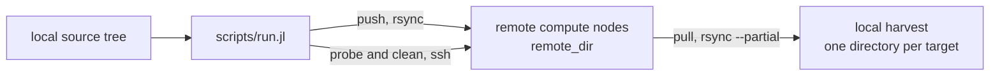

# SshDataBridge.jl

[](https://github.com/PaulGoG/SshDataBridge.jl/actions/workflows/CI.yml)
[](https://github.com/PaulGoG/SshDataBridge.jl/releases/latest)
[](LICENSE)
[](https://julialang.org)
[](#environment-setup)
[](https://github.com/JuliaTesting/Aqua.jl)

Deploys a simulation code base to several remote compute nodes over SSH and rsync and later harvests their results, on all nodes in parallel. One TOML file describes the nodes and paths.

```
SshDataBridge/
├── src/                   # Package: configuration parser, ssh and rsync commands, CLI driver
├── scripts/run.jl         # Command-line entry point: probe | push | pull | clean
├── sandbox/run.jl         # Every action exercised against stub binaries, no network
├── test/                  # Test suite and its environment
├── format/                # Formatting environment and script
├── config.example.toml    # Configuration template
├── activate.jl            # Activates and instantiates the root environment
├── Project.toml
├── CHANGELOG.md
└── SECURITY.md
```

The complete tree is under [Repository layout](#repository-layout).

## Environment setup

Linux with the OpenSSH client, `sshpass`, and `rsync` on the workstation; `rsync` on every remote node; Julia 1.10 or later.

```bash
sudo dnf install sshpass rsync openssh-clients          # Fedora, RHEL
sudo apt-get install sshpass rsync openssh-client       # Debian, Ubuntu
```

Clone the repository and run it in place; the driver script activates the root environment itself:

```bash
git clone https://github.com/PaulGoG/SshDataBridge.jl.git
cd SshDataBridge.jl
julia activate.jl          # root environment (standard libraries only)
julia test/activate.jl     # test environment, developed against the local source
julia format/activate.jl   # formatting environment
```

The package is not registered. To use the library API from another environment, add it by URL:

```bash
julia -e 'using Pkg; Pkg.add(url="https://github.com/PaulGoG/SshDataBridge.jl")'
```

## Entry points

```bash
install -m 600 config.example.toml config.toml          # then edit paths, hosts, and credentials
julia scripts/run.jl probe                              # reachability, remote rsync, directories
julia scripts/run.jl push --dry-run                     # print the rsync commands
julia scripts/run.jl push                               # deploy to all targets
julia scripts/run.jl pull                               # harvest all targets
julia scripts/run.jl pull --clean-remote --yes          # harvest, verify, then purge the project from the nodes
julia scripts/run.jl pull --target Cluster-Node-02      # one target only; --target is repeatable
julia scripts/run.jl clean --yes                        # purge without harvesting
julia scripts/run.jl clean --dry-run                    # show what a purge would remove
julia test/runtests.jl                                  # test suite
julia sandbox/run.jl                                    # every action against stub binaries, no network
julia format/format.jl                                  # format the sources
julia format/format.jl --check                          # verify formatting without writing
```

`--config <path>` selects another configuration file; the default is `config.toml` next to `Project.toml`. The exit status is 0 when every target succeeded, 2 when at least one failed, and 1 on a configuration or precondition error. `--config` may be given once; `--target <name>` restricts any action to the named targets, may be repeated, and refuses an unknown name before anything runs; `--clean-remote` applies to `pull` and `--yes` to `pull` and `clean`.

The script only activates the environment and calls `SshDataBridge.main(args; io, err)`, which returns that exit status instead of calling `exit` and writes the summary tables to `io` and the diagnostics to `err`. Call it from Julia to drive a campaign from another project or to test a configuration in process:

```julia
using SshDataBridge
SshDataBridge.main(["probe", "--config", "config.toml"])
```

## Component status

| Component | Status |
|---|---|
| TOML configuration parser and field validation | Stable |
| `probe`, `push`, `pull` | Stable; covered by process tests against stub binaries; every transfer logged per target |
| `clean` and the post-harvest purge | Stable; `--yes` gate, lexical path rules, a remote guard against symbolic links and the home directory, and harvest verification covered by tests |
| Credential delivery to `sshpass` over standard input | Stable; redaction asserted by the test suite and the sandbox |
| `push --delete`, retries, key-based authentication | Not implemented |

## How it works



Every action runs on all targets concurrently, and a failure on one target does not stop the others. A purge removes the whole project directory from the node, or only its output directory with `purge_scope = "output"`; after a pull it runs only once a verification pass finds the local copy complete, and it is never combined with include patterns. [Actions](#actions) has the details.

## Configuration

`config.toml` holds passwords: git ignores every `.toml` file except the template and the environment files, and the loader refuses a file readable by other users. Unknown keys and values of the wrong type are rejected before anything runs, naming the key; relative local paths are resolved against the directory of the configuration file and a leading `~` expands to the home directory. `local_source_dir`, `local_destination_root`, and the target `name` are mandatory; every other key has a default.

```toml
[globals]
connect_timeout = 10                  # integer > 0; units: s
strict_host_key_checking = "accept-new"   # one of: "accept-new" | "yes" | "no"
compress = true                       # rsync -z
bandwidth_limit = 0                   # integer >= 0; units: KB/s; 0 = unlimited
server_alive_interval = 15            # integer >= 0; units: s; 0 = ssh client configuration decides
server_alive_count_max = 3            # integer >= 1; unanswered keepalives before ssh disconnects

[push]
local_source_dir = "~/projects/sim_batch_01"   # mandatory; directory deployed to every target
excludes = [".git", ".github", ".vscode", "*.swp", "*~"]   # rsync exclude patterns (the default)
includes = []                         # rsync include patterns applied before the .gitignore filter
use_gitignore = true                  # apply the .gitignore of the source tree
require_clean_git = false             # refuse to deploy from a dirty working tree

[pull]
local_destination_root = "~/campaigns/sim_batch_01/harvest"   # mandatory; one subdirectory per target, plus the rsync logs
output_subdir = "output"              # default remote output directory, relative to remote_dir
includes = []                         # harvest only matching files; empty = everything
excludes = ["*.tmp", "core.*", "*~"]  # rsync exclude patterns
collision_strategy = "resume"         # one of: "resume" | "backup" | "abort"
clean_remote_after_pull = false       # purge after a verified harvest (needs --yes)
purge_scope = "project"               # one of: "project" | "output"

[[targets]]
name = "Cluster-Node-01"              # mandatory, unique; letters, digits, '.', '_', '-'; names the local harvest directory
host = "192.168.1.100"                # hostname, IPv4 address, or IPv6 literal without brackets
port = 22                             # integer in [1, 65535]
user = "scientist"
password = "example_password_1"
remote_dir = "/home/scientist/campaigns/sim_batch_01"   # absolute
output_subdir = "output"              # optional; overrides [pull].output_subdir
strict_host_key_checking = "accept-new"   # optional override
```

## Actions

**probe** runs a short shell script on every target over ssh and reports whether the host answered, whether `rsync` is installed there, and whether the base and output directories exist. Nothing is modified.

**push** creates `remote_dir` if needed and runs `rsync -a --partial` from `local_source_dir`, which must exist, to it. The files transferred are appended to `local_destination_root/<name>.push.rsync.log`, and the summary line reports how many files and bytes were transferred. With `use_gitignore` the `.gitignore` rules of the source tree are applied through a dir-merge filter, so whatever the deployed project ignores stays local without repeating the rules in `excludes`; rsync reads the files as plain exclude lists, so `!` negations, `.git/info/exclude`, and `core.excludesFile` have no effect. `.git` is deployed unless `excludes` lists it, as the default list does. `includes` re-admit paths that the `.gitignore` filter would drop, `excludes` taking precedence; `Manifest.toml` is the usual case. It is not deployed by default: a manifest resolved on the workstation instantiates cleanly only on the same Julia minor version, so ship it with `includes = ["/Manifest.toml"]` when every node runs that version, and otherwise let each node resolve its own environment and keep the node's manifest with the harvested results as the provenance of the run. `--delete` is not used, so files removed locally stay on the nodes. With `require_clean_git` the tree below `local_source_dir` must have no uncommitted changes; the check also applies to dry runs.

**pull** retrieves `remote_dir/output_subdir/` of every target into `local_destination_root/<name>/`. `--partial` resumes interrupted transfers. The files transferred are appended to `local_destination_root/<name>.pull.rsync.log`; the summary line reports the file count and size, and the log is the record of what was retrieved before any purge. With `includes` set, only files matching one of the patterns are harvested and directories left empty are skipped; `excludes` take precedence, and a purge cannot be combined with include patterns, because the files the filter leaves behind would be lost. When the local directory already exists, `collision_strategy` decides: `resume` reuses it, `backup` renames it to `<name>#1`, `<name>#2`, ... before creating a fresh one, `abort` fails the target. A destination that cannot be created fails that target only.

**clean** removes the directory selected by `purge_scope`: the whole `remote_dir` by default, or only the output directory with `"output"`. The default is the project because a campaign deploys code that is not meant to stay on the nodes. The same purge runs after a pull when `--clean-remote` is given or `clean_remote_after_pull` is set, but only once the harvest is verified: the transfer is repeated as `rsync --dry-run --itemize-changes`, and any item it still reports (a job still writing, for instance) keeps the remote directory and fails that target although its data were retrieved. Rerun the pull for that target (`--target <name>`) once the node is idle. A purge destroys everything in its scope that the harvest did not copy: files matching `excludes` and, with the `project` scope, everything outside `output_subdir`. Every purge outside a dry run requires `--yes` on the command line. Before any transfer the path of every target is checked: it must be absolute, at least two components deep, free of `..`, and neither `/`, `/root`, `/home`, the user's home directory, nor anything under `/usr`, `/etc`, `/var`, and the other system directories. On the node the removal runs as a short POSIX script under `sh -c` that refuses a symbolic link, whose removal would leave the deployed tree in place, and a directory that contains the account's home directory; a refusal fails the target with exit status 98.

Each action ends with a plain-text summary: one block or line per target with its outcome, exit code, duration, and message, then a tally.

Every ssh connection, the rsync transport included, sends a keepalive request after `server_alive_interval` seconds of silence from the server and disconnects after `server_alive_count_max` unanswered requests. With the defaults a dead connection fails the target within about a minute instead of blocking it for up to two hours; rerun the action, and a pull resumes where it stopped. With `server_alive_interval = 0` no keepalive option is passed and the ssh client configuration applies.

## Security model

The password of each target is read from `config.toml`, which the loader accepts only when it is not readable by other users. Every remote command runs as `sshpass -d 0 ...`, and the package writes the password to the standard input of `sshpass`, which forwards it to the ssh password prompt. The password therefore appears in no command line, process environment, or file; `ps`, `/proc/<pid>/cmdline`, and `/proc/<pid>/environ` do not show it. Dry-run output, log lines, and the printed form of every configuration and result object omit it as well. `ssh` runs with public-key authentication disabled and the preferred methods pinned to keyboard-interactive and password, so an agent holding many keys cannot exhaust the server's authentication attempts and an encrypted key cannot raise a passphrase prompt that `sshpass` does not answer.

What remains is inherent to password authentication: any process running as the same user can read `config.toml` and could attach to `sshpass` while it runs. Where the nodes accept keys, plain ssh with an agent is the better tool.

Host keys follow `strict_host_key_checking`: `accept-new` (default) records a host on first contact and refuses a changed key afterwards, `yes` refuses unknown hosts, `no` disables verification and is only acceptable for throwaway test clusters. Every ssh invocation allows one password prompt; the probe, mkdir, and purge commands also run with `-n`, so they cannot read from the local terminal. Vulnerability reports: see [SECURITY.md](SECURITY.md).

## Limitations

- Linux only; developed on Fedora, tested in CI on Ubuntu.
- Password authentication only; ssh keys and agents are not used.
- `push` never deletes remote files.
- A purge removes `remote_dir` only. Julia stores the source text of every precompiled package in its cache files, so a private package deployed with this tool stays readable under `~/.julia/compiled/` on the node until that cache is removed as well.
- Targets run as cooperative tasks on one thread; the work is bound by the network and by rsync.
- No retry logic; rerun the action with `--target` for the targets that failed.

## Repository layout

<details>
<summary>Full file tree</summary>

```
SshDataBridge/
├── .github/
│   ├── dependabot.yml       # Weekly updates of the GitHub Actions pins and the test and formatting environments
│   └── workflows/
│       └── CI.yml           # Test suite and formatting check on Julia LTS, stable, and pre-release
├── .gitignore               # Every .toml except the tracked ones, coverage and editor artifacts
├── .JuliaFormatter.toml     # YAS style, 92 columns
├── CHANGELOG.md             # Release history
├── LICENSE                  # MIT
├── Project.toml             # Package metadata; standard-library dependencies only
├── README.md
├── SECURITY.md              # Threat model and vulnerability reporting
├── activate.jl              # Activates and instantiates the root environment
├── config.example.toml      # Annotated configuration template
├── format/
│   ├── Project.toml         # Formatting environment (JuliaFormatter 2.14+)
│   ├── activate.jl          # Activates the formatting environment
│   └── format.jl            # Formats the repository; --check verifies without writing; refuses files that do not parse
├── sandbox/
│   └── run.jl               # Exercises every action in process against stub binaries, no network
├── scripts/
│   └── run.jl               # Thin entry point around SshDataBridge.main
├── src/
│   ├── SshDataBridge.jl     # Module and exports
│   ├── validation.jl        # Field grammars and remote-path safety rules
│   ├── types.jl             # Configuration, result, and exception types
│   ├── process.jl           # Credential delivery and process execution
│   ├── config.jl            # Typed TOML parser
│   ├── probe.jl             # ssh commands: probe, mkdir, purge
│   ├── transfer.jl          # rsync commands: push, pull; clean-tree check
│   └── cli.jl               # Command-line driver: probe | push | pull | clean
└── test/
    ├── Project.toml         # Test environment: Aqua, JET, ExplicitImports
    ├── activate.jl          # Activates the test environment against the local source
    └── runtests.jl          # Static analysis, unit tests, stub-binary process tests
```

</details>

## License

MIT, see [LICENSE](LICENSE).
