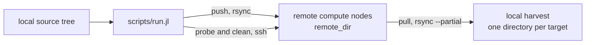

# SshDataBridge.jl

[](https://PaulGoG.github.io/SshDataBridge.jl/stable/)
[](https://github.com/PaulGoG/SshDataBridge.jl/actions/workflows/CI.yml?query=branch%3Amain)
[](https://github.com/JuliaTesting/Aqua.jl)
[](https://github.com/aviatesk/JET.jl)
[](https://github.com/jrevels/YASGuide)
[](https://github.com/PaulGoG/SshDataBridge.jl/actions/workflows/Format.yml?query=branch%3Amain)
[](https://julialang.org/downloads/)
[](#environment-setup)

Deploys a simulation code base to several remote compute nodes with rsync over ssh and later harvests their results, on all nodes in parallel. One TOML file describes the nodes and the paths; a node authenticates with a password from the file, or with the keys and host aliases of `~/.ssh/config`.

```
SshDataBridge.jl/
├── src/                   # Package: configuration parser, ssh and rsync commands, CLI driver
├── scripts/run.jl         # Command-line entry point: probe | push | pull | clean
├── test/                  # Test suite and its environment
├── docs/                  # Documentation site: configuration reference and library API
├── format/                # Formatting environment and script
├── config.example.toml    # Configuration template
├── activate.jl            # Activates and instantiates the root environment
├── Project.toml
├── CHANGELOG.md
└── SECURITY.md
```

The complete tree is under [Repository layout](#repository-layout). The configuration reference and the library API are published as a [documentation site](https://PaulGoG.github.io/SshDataBridge.jl/).

## Environment setup

Linux workstation with the OpenSSH client (8.4 or newer for key targets) and `rsync`, and `sshpass` when the configuration holds a password target. Every remote node needs `rsync` as well, version 3.0 or newer on both sides. Julia 1.10 or later.

```bash
sudo dnf install sshpass rsync openssh-clients          # Fedora, RHEL
sudo apt-get install sshpass rsync openssh-client       # Debian, Ubuntu
```

Clone the repository and run it in place; the driver script activates the root environment itself:

```bash
git clone https://github.com/PaulGoG/SshDataBridge.jl.git
cd SshDataBridge.jl
julia activate.jl          # root environment (standard libraries only)
julia test/activate.jl     # test environment, developed against the local source
julia docs/activate.jl     # documentation environment
julia format/activate.jl   # formatting environment
```

The package is not registered. To use the library API from another environment, add it by URL:

```bash
julia -e 'using Pkg; Pkg.add(url="https://github.com/PaulGoG/SshDataBridge.jl")'
```

## Entry points

```bash
install -m 600 config.example.toml config.toml          # then edit paths, hosts, and credentials
julia scripts/run.jl probe                              # reachability, remote rsync, directories
julia scripts/run.jl push --dry-run                     # print the rsync commands
julia scripts/run.jl push                               # deploy to all targets
julia scripts/run.jl pull                               # harvest all targets
julia scripts/run.jl pull --clean-remote --yes          # harvest, verify, then purge the project from the nodes
julia scripts/run.jl pull --target Cluster-Node-02      # one target only; --target is repeatable
julia scripts/run.jl clean --yes                        # purge without harvesting
julia scripts/run.jl clean --dry-run                    # show what a purge would remove
julia test/runtests.jl                                  # test suite
julia docs/make.jl                                      # build the documentation into docs/build
julia format/format.jl                                  # format the sources
julia format/format.jl --check                          # verify formatting without writing
```

`--config <path>` selects another configuration file; the default is `config.toml` next to `Project.toml`, and the option may be given once. `--target <name>` restricts any action to the named targets and may be repeated; an unknown name stops the run before any node is contacted. `--clean-remote` applies to `pull` only, `--yes` to `pull` and `clean`. The exit status is 0 when every target succeeded, 2 when at least one failed, and 1 on a usage, configuration, or precondition error.

The script only activates the environment and calls `SshDataBridge.main(args; io, err)`, which returns that exit status instead of calling `exit`. The summary tables go to `io` and the diagnostics to `err`. Call it from Julia to drive a campaign from another project or to test a configuration in process:

```julia
using SshDataBridge
SshDataBridge.main(["probe", "--config", "config.toml"])
```

## Component status

| Component | Status |
|---|---|
| TOML configuration parser and field validation | Stable |
| `probe`, `push`, `pull` | Stable |
| `clean` and the post-harvest purge | Stable |
| Credential delivery to `sshpass` over standard input | Stable |
| Key-based targets, ssh_config host aliases, ownership marker | Experimental |
| `push --delete`, retries | Not implemented |

## How it works



Every action runs on all selected targets concurrently, and a failure on one node does not stop the others. A purge removes the whole project directory from the node unless `purge_scope = "output"`, and after a pull it runs only once a verification pass has found the local copy complete; see [Actions](#actions).

## Configuration

`config.toml` may hold passwords in plain text: git ignores every `.toml` file in the clone except the tracked ones, and the loader refuses a file that grants any permission to group or others. Unknown keys and values of the wrong type are rejected before any node is contacted, and the message names the key. Relative local paths are resolved against the directory of the configuration file, and a leading `~` expands to the home directory. `remote_dir` and `output_subdir` must not contain `..` segments or the characters `*`, `?`, `[`, `]`, which rsync would expand on the node. Two targets on the same host and port must not share a `remote_dir` or nest one inside the other, whatever the `purge_scope`: a project purge of one would remove the output of the other before it is harvested, and both would be deployed into one tree. The loader compares the configured hosts; before any action the driver asks `ssh -G` for the host name, port, and user that ssh will actually use for every target, and compares those, so that an alias and the name it stands for, or a port set only in `~/.ssh/config`, cannot hide two targets on one node. Host names are compared without case, IP addresses by the value the C library reads, as ssh does. A numeric `host` with a field in octal or hexadecimal notation (`192.0.2.012`, `0xc0.0.2.10`) is refused, and so is one that the C library does not read as an address (`192.168.1.256`, `2001:db8:10`). `[push].local_source_dir`, `[pull].local_destination_root`, and the target keys `name`, `host`, and `remote_dir` are mandatory, and `password` for a password target; every other key has a default. `port` and `user` are optional: a key left out is not passed to ssh, so `~/.ssh/config` decides, and a key set in the file overrides it.

`auth` selects how a target authenticates. A password target (`auth = "password"`, the default) needs `password`. A key target (`auth = "key"`) must not carry one: ssh authenticates with the agent, an identity file, a certificate, or an open master connection, as `~/.ssh/config` provides, and is never allowed to prompt, because every target runs in the background. A key passphrase is therefore served by the agent, and a second factor by a master connection opened beforehand (`ControlMaster` with `ControlPersist` in `~/.ssh/config`, then `ssh -fN <host>` once). A key target may name `identity_file`, an absolute path or one starting with `~`, which must be a regular file without group or other permissions and without a single quote; it is offered alone (`-i <path> -o IdentitiesOnly=yes`). It may also name `proxy_jump`, passed as `ssh -J`: `[user@]host[:port]` hops separated by commas, IPv6 addresses in brackets, or `none` to disable a `ProxyJump` of `~/.ssh/config`.

```toml
[globals]
connect_timeout = 10                  # integer > 0; units: s
strict_host_key_checking = "accept-new"   # one of: "accept-new" | "yes" | "no"
compress = true                       # rsync -z
bandwidth_limit = 0                   # integer >= 0; units: KiB/s; 0 = unlimited
server_alive_interval = 15            # integer >= 0; units: s; 0 = ssh client configuration decides
server_alive_count_max = 3            # integer >= 1; unanswered keepalives before ssh disconnects

[push]
local_source_dir = "~/projects/sim_batch_01"   # mandatory; directory deployed to every target
excludes = [".git", ".github", ".vscode", "*.swp", "*~"]   # rsync exclude patterns (the default)
includes = []                         # rsync include patterns applied before the .gitignore filter
use_gitignore = true                  # apply the .gitignore of the source tree
require_clean_git = false             # refuse to deploy from a dirty working tree

[pull]
local_destination_root = "~/campaigns/sim_batch_01/harvest"   # mandatory; one subdirectory per target, plus the rsync logs
output_subdir = "output"              # default remote output directory, relative to remote_dir
includes = []                         # harvest only matching files; empty = everything
excludes = ["*.tmp", "*~"]            # rsync exclude patterns (the default)
collision_strategy = "resume"         # one of: "resume" | "backup" | "abort"
clean_remote_after_pull = false       # purge after a verified harvest (needs --yes)
purge_scope = "project"               # one of: "project" | "output"

[[targets]]
name = "Cluster-Node-01"              # mandatory, unique; starts with a letter or digit, then letters, digits, '.', '_', '-'; names the local harvest directory
host = "192.168.1.100"                # hostname, ssh_config Host alias, IPv4 address in decimal fields, or IPv6 literal without brackets
port = 22                             # optional; integer in [1, 65535]
user = "scientist"                    # optional
password = "example_password_1"       # password targets only
remote_dir = "/home/scientist/campaigns/sim_batch_01"   # absolute; no '..', '*', '?', '[', ']'
output_subdir = "output"              # optional; overrides [pull].output_subdir
strict_host_key_checking = "accept-new"   # optional override

[[targets]]
name = "Cluster"
host = "hpc"                          # a Host alias of ~/.ssh/config
auth = "key"                          # one of: "password" | "key"; default "password"
identity_file = "~/.ssh/id_ed25519_hpc"   # optional, key targets only
proxy_jump = "admin@gateway.example.org"  # optional, key targets only
remote_dir = "/scratch/scientist/campaigns/sim_batch_01"
```

## Actions

**probe** runs a short shell script on every target over ssh and reports whether the host answered, whether `rsync` is installed there, and whether the base and output directories exist. Nothing is modified. A key target refused with `Permission denied` gets a hint: the key belongs in the agent, or, for a second factor, a master connection must be open.

**push** checks that `local_source_dir` exists, creates `remote_dir` on the node if needed and claims it for the target, and runs `rsync -a --partial -s` from the one to the other. The claim writes the ownership marker `remote_dir/.sshdatabridge-target`, which holds the target name, by an atomic hard link; a push into a directory whose marker names another target is refused before anything is transferred. Two targets on nodes that share storage, a cluster's `/home` or scratch space for instance, are caught that way at the first deployment, although their hosts differ. The files transferred are appended to `local_destination_root/<name>.push.rsync.log`, and the summary line reports how many files and bytes were transferred. `--delete` is not used, so files removed locally stay on the nodes. With `require_clean_git` the tree below `local_source_dir` must have no uncommitted changes, in dry runs as well.

With `use_gitignore` the `.gitignore` rules of the source tree are applied through a dir-merge filter, so whatever the deployed project ignores stays local without repeating the rules in `excludes`. The files are read by rsync as plain exclude lists, so `!` negations, `.git/info/exclude`, and `core.excludesFile` have no effect. `.git` is deployed unless `excludes` lists it, as the default list does.

`includes` re-admit paths that the `.gitignore` filter would drop; `excludes` still take precedence. `Manifest.toml` is the usual case. It is not deployed by default, because a manifest resolved on the workstation instantiates cleanly only on the same Julia minor version. Ship it with `includes = ["/Manifest.toml"]` when every node runs that version. Otherwise let each node resolve its own environment, and keep the node's manifest with the harvested results as the provenance of the run.

**pull** retrieves `remote_dir/output_subdir/` of every target into `local_destination_root/<name>/`. `--partial` resumes interrupted transfers. The files transferred are appended to `local_destination_root/<name>.pull.rsync.log`, which is the record of what was retrieved before any purge, and the summary line reports the file count and size. With `includes` set, only files matching one of the patterns are harvested and directories left empty are skipped; `excludes` take precedence. A purge cannot be combined with include patterns, because the files the filter leaves behind would be lost. When the local directory already exists, `collision_strategy` decides: `resume` reuses it, `backup` renames it to `<name>#1`, `<name>#2`, ... before creating a fresh one, `abort` fails the target. A destination that cannot be created fails that target only.

**clean** removes the directory selected by `purge_scope`: the whole `remote_dir` by default, or only the output directory with `"output"`. The default is the whole project because a campaign deploys code that is not meant to stay on the nodes. On the command line, every purge outside a dry run requires `--yes`. A purge destroys everything in its scope that the harvest did not copy: files matching `excludes` (by default `*.tmp` and `*~`) and, with the `project` scope, everything outside `output_subdir`.

The same purge runs after a pull when `--clean-remote` is given or `clean_remote_after_pull` is set, but only once the harvest is verified. The transfer is repeated as `rsync --dry-run --itemize-changes`. If that pass still reports an item (a job still writing, for example), nothing is deleted and the target fails, although its data were retrieved. Rerun the pull for that target (`--target <name>`) once the node is idle. The pass is a snapshot: output written after it is deleted unharvested, so purge only nodes whose jobs have finished.

When a purge is requested, the driver checks the purge path of every target before any transfer. The path must be absolute, at least two components deep, free of `..`, and neither `/`, `/root`, `/home`, `/home/<user>`, nor anything under `/usr`, `/etc`, `/var`, and the other system directories. On the node the removal runs as a short POSIX script under `sh -c`. It refuses a symbolic link, whose removal would leave the deployed tree in place, a path it cannot enter (a file, or a directory without search permission), a directory that contains the account's home directory, and a path at which, above which, or below which lies the ownership marker of another target; a refusal fails the target with exit status 98 and its reason. A purge that finds no marker of its target, on a project deployed before markers existed or one that was never pushed, proceeds and says so. The marker is never harvested and goes with the project when it is purged.

Each action ends with a plain-text summary: one block or line per target with its outcome, exit code, duration, and message, then a tally.

Every ssh connection, including the rsync transport, sends a keepalive request after `server_alive_interval` seconds of silence from the server and disconnects after `server_alive_count_max` unanswered requests. With the defaults a dead connection fails the target within about a minute instead of blocking it for up to two hours. Rerun the action; a pull resumes where it stopped. With `server_alive_interval = 0` no keepalive option is passed and the ssh client configuration applies.

## Security model

The password of a password target is read from `config.toml`, which the loader refuses unless it is private to its owner. Every remote command of such a target runs as `sshpass -d 0 ...`, and the package writes the password to the standard input of `sshpass`, which forwards it to the ssh password prompt. The password therefore appears in no command line or process environment, and the package never writes it to disk; `ps`, `/proc/<pid>/cmdline`, and `/proc/<pid>/environ` do not show it. Dry-run output, log lines, error messages, and the printed form of every configuration and result object omit it as well; a syntax error in the configuration is reported by its line number, without the line. For a password target `ssh` runs with public-key authentication disabled and the preferred methods pinned to keyboard-interactive and password. An agent holding many keys therefore cannot exhaust the server's authentication attempts, and an encrypted key cannot raise a passphrase prompt that `sshpass` does not answer. What remains is inherent to password authentication: any process running as the same user can read `config.toml` and could attach to `sshpass` while it runs. `sshpass` also answers the first password prompt it sees, so `proxy_jump` is refused on a password target, and the driver warns when `~/.ssh/config` routes one through a jump host: if that jump host asked for a password, it would receive the target's.

A key target hands the package no secret. Its commands run with `BatchMode=yes`, so ssh fails instead of prompting. `BatchMode` does not reach the ssh that `ProxyJump` starts for a jump host, so every command of a key target also carries `SSH_ASKPASS=false` and `SSH_ASKPASS_REQUIRE=force`, which that ssh inherits: a passphrase, password, or host-key prompt anywhere on the route goes to a program that refuses, instead of to the terminal or to a desktop dialog. The loader checks the mode of a configured identity file and never reads it.

Host keys follow `strict_host_key_checking`: `accept-new` (default) records a host on first contact and refuses a changed key afterwards, `yes` refuses unknown hosts, `no` disables verification and is only acceptable for throwaway test clusters. Every ssh invocation of a password target allows one password prompt; the probe, claim, and purge commands also run with `-n`, so they cannot read from the local terminal. Vulnerability reports: see [SECURITY.md](SECURITY.md).

## Limitations

- Linux only. I develop on Fedora; CI runs on Ubuntu.
- `push` never deletes remote files.
- A purge removes `remote_dir` only. Julia stores the source text of every precompiled package in its cache files, so a private package deployed with this tool stays readable under `~/.julia/compiled/` on the node until that cache is removed as well.
- The refusal of overlapping remote directories compares the host names and ports that ssh evaluates, not the storage behind them; nodes that share storage are caught by the ownership marker instead, once a target has pushed. Neither recognizes a project that was never pushed (a pull-only configuration), two configuration files that use one target name for one directory, or a host name and its address. When nodes share storage, configure one target for it or give each target its own `remote_dir`.
- The ownership marker is created by a hard link: on a remote filesystem without hard links every push fails at the claim.
- Key targets cannot answer a prompt: an encrypted key must be in the agent, and a host that asks for a second factor needs a master connection opened beforehand.
- Targets run as cooperative tasks on one thread; the work is bound by the network and by rsync.
- No retry logic; rerun the action with `--target` for the targets that failed.

## Repository layout

<details>
<summary>Full file tree</summary>

```
SshDataBridge.jl/
├── .github/
│   ├── dependabot.yml       # Weekly updates of the GitHub Actions pins and the test, documentation, and formatting environments
│   └── workflows/
│       ├── CI.yml           # Test suite on Julia LTS, stable, and pre-release; documentation build and deployment
│       └── Format.yml       # Formatting check
├── .gitignore               # Every .toml except the tracked ones; documentation build, coverage, and editor artifacts
├── .JuliaFormatter.toml     # YAS style, 92 columns
├── CHANGELOG.md             # Release history
├── LICENSE                  # MIT
├── Project.toml             # Package metadata; standard-library dependencies only
├── README.md
├── SECURITY.md              # Threat model and vulnerability reporting
├── activate.jl              # Activates and instantiates the root environment
├── config.example.toml      # Annotated configuration template
├── docs/
│   ├── Project.toml         # Documentation environment (Documenter)
│   ├── activate.jl          # Activates the documentation environment against the local source
│   ├── make.jl              # Builds the site into docs/build; CI deploys it
│   └── src/
│       ├── index.md         # Overview, installation, use from Julia
│       ├── configuration.md # Rules of the configuration file and the template
│       ├── api.md           # Exported names and SshDataBridge.main
│       └── internals.md     # Docstrings of the internal functions
├── format/
│   ├── Project.toml         # Formatting environment (JuliaFormatter 2.14)
│   ├── activate.jl          # Activates the formatting environment
│   └── format.jl            # Formats the repository; --check verifies without writing
├── scripts/
│   └── run.jl               # Thin entry point around SshDataBridge.main
├── src/
│   ├── SshDataBridge.jl     # Module and exports
│   ├── validation.jl        # Field grammars and remote-path safety rules
│   ├── types.jl             # Configuration, result, and exception types
│   ├── process.jl           # Credential delivery and process execution
│   ├── config.jl            # Typed TOML parser
│   ├── probe.jl             # ssh commands: probe, mkdir, purge
│   ├── transfer.jl          # rsync commands: push, pull; clean-tree check
│   └── cli.jl               # Command-line driver: probe | push | pull | clean
└── test/
    ├── Project.toml         # Test environment: Aqua, JET, ExplicitImports
    ├── activate.jl          # Activates the test environment against the local source
    └── runtests.jl          # Static analysis, unit tests, stub-binary process tests, command-line scenarios
```

</details>

## License

MIT, see [LICENSE](LICENSE).
